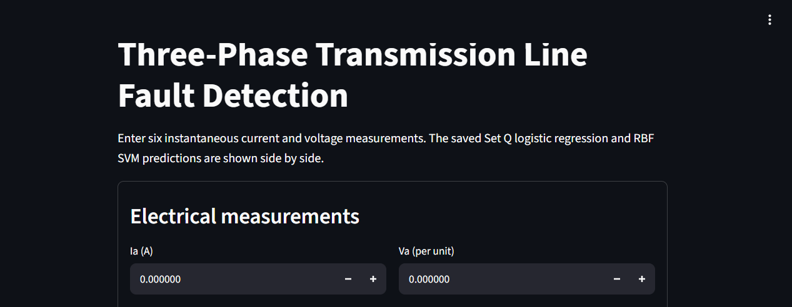

# Assignment 2 — Detecting Faults on a Three-Phase Transmission Line

**Course:** AI4003 Applied Machine Learning, Fall 2026

**Methods:** Logistic regression implemented with NumPy; linear and RBF Support Vector Machines (SVMs) using `sklearn.svm.SVC`.

## Project Structure

```text
Assignment_2_Fault_Detection/
├── data/
│   └── detect dataset.csv
├── src/
│   ├── load_data.py
│   ├── prepare.py
│   ├── eda.py
│   ├── logistic.py
│   ├── metrics.py
│   ├── train_logistic.py
│   ├── train_svm.py
│   └── test_models.py
├── results/
│   ├── Task 1 preparation and column-inspection tables
│   ├── Three required Task 2 exploratory plots and explanations
│   ├── Two required logistic-regression cost-curve figures
│   ├── Logistic-regression weights and result table
│   ├── SVM validation table, comparison plot, and selected models
│   ├── Final test table and confusion matrices
│   └── Task 6 analysis
├── app/
│   └── app.py
├── requirements.txt
└── README.md
```

## Dataset

The included `data/detect dataset.csv` is the dataset supplied for this project. It contains 12,001 rows and nine columns. The completely empty columns `Unnamed: 7` and `Unnamed: 8` are removed during preparation.

The target column `Output (S)` is renamed to `fault`:

- `0` means no fault.
- `1` means fault.

## Installation and Run Instructions

Install the required dependencies from the project root:

```bash
pip install -r requirements.txt
```

Run the project scripts in the following order:

```bash
python src/load_data.py
python src/prepare.py
python src/eda.py
python src/train_logistic.py
python src/train_svm.py
python src/test_models.py
```

Launch the frontend after training:

```bash
streamlit run app/app.py
```

## Results from the Supplied Dataset

| Item | Result |
|---|---:|
| Raw rows / columns | 12,001 / 9 |
| Empty columns removed | 2 |
| Fault rows | 5,496 |
| No-fault rows | 6,505 |
| Training rows | 7,200 |
| Validation rows | 2,400 |
| Test rows | 2,401 |
| Selected logistic-regression learning rate, Set R | 1 |
| Selected logistic-regression learning rate, Set Q | 10 |
| Best validation linear SVM | C = 0.1 |
| Best validation RBF SVM | C = 100, gamma = 1 |

### Final Test Accuracy

| Model | Test accuracy | Missed faults |
|---|---:|---:|
| Logistic regression — Set R | 72.64% | 657 |
| Logistic regression — Set Q | 97.88% | 45 |
| Linear SVM | 73.59% | 634 |
| RBF SVM | 99.58% | 6 |

The CSV tables in `results/` contain the metrics, confusion matrices, learned coefficients, split fractions, and validation results. These values were generated using the dataset included with this project.

## Assignment Restrictions Followed

- Data splitting uses `numpy.random.default_rng(42)` with the required 60% training, 20% validation, and remaining test split.
- Feature standardisation uses training-set statistics only.
- Logistic regression, the sigmoid function, cost calculation, batch gradient descent, prediction, accuracy, and confusion-matrix calculation are implemented directly using NumPy.
- The only scikit-learn model used for fitting is `sklearn.svm.SVC`.
- Validation data is used to select learning rates and SVM hyperparameters. The test set is reserved for the final four-model evaluation.

## Before Submission

- [ ] Run the app and include a real screenshot of the interface in this README, as required by the assignment manual.
- [ ] Keep the repository public and ensure both group members make meaningful commits.

## Frontend Screenshot


